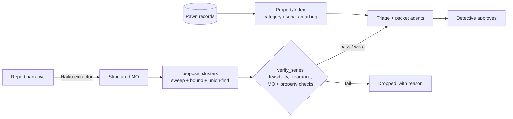
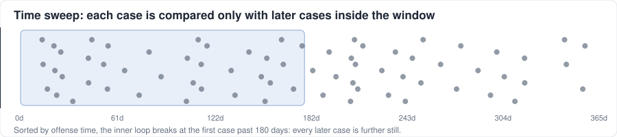
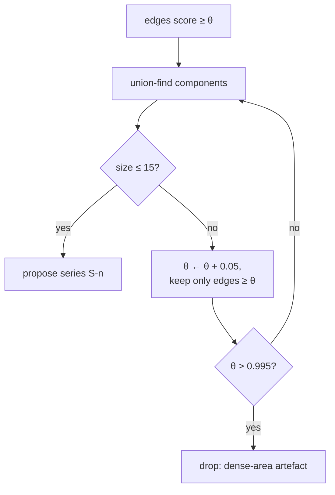
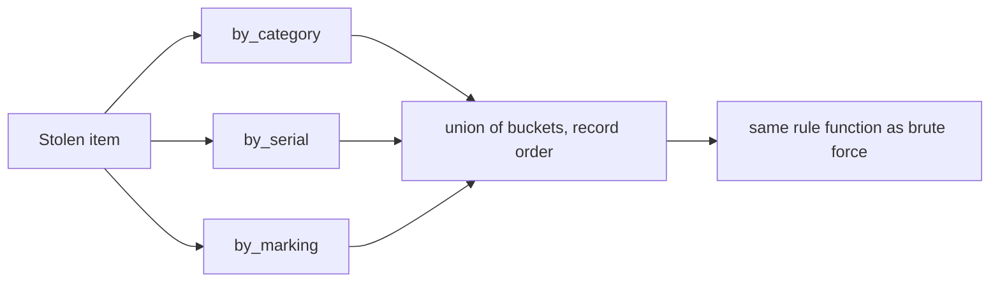

# Cracking the Burglary Backlog — Team 6

Working space for research, financial assumptions, and a synthetic-data prototype. The final deliverable is a presentation; use Google Slides for collaborative slide editing and put its link below.

## Logistics
- Deck: Friday, November 6, 2026, 1:00 PM Pacific, per Daniel's email. PDF or Google Slides link; under 10 slides.
- Pitch: 3:03 PM, DEM 004; arrive by 2:53 PM. Seven-minute presentation including demo, three-minute Q&A.
- Team: Shaurya Agarwal, Steven Carmona, Kevin Pham, Gowrav Shivakumara, Sonny Choi.
- Slides link: TBD

## Start here
1. Read [the brief](brief.md) and [workshop notes](research/workshop-notes.md).
2. Choose one bottleneck. Video review is a starting hypothesis, not a settled recommendation.
3. Assign an owner to research, economics, prototype, ethics/pilot, and presentation coordination.
4. Record sources in [the evidence log](research/sources.md); calculate benefits in [the model](analysis/model.md).
5. Build the story using [the slide outline](slides/outline.md).

## Working rules
Public or synthetic data only. No facial recognition. Humans make decisions affecting people. Do not commit credentials, real police data, personal email, or sensitive records.
Case facts, external evidence, workshop observations, and assumptions must be labeled separately. AI output is not evidence by itself.
Discord is for discussion and research updates; accepted findings and calculations belong here. No Discord integration is installed yet.

## Casefile prototype (Option C, recorded in #decisions)
Rust workspace: case linkage plus pawn/serial matching, detective-approved next steps. Synthetic data only.
- Run: `cargo run -- serve` then http://localhost:8080 (details in [docs/CASEFILE_README.md](docs/CASEFILE_README.md))
- Deck PDF, demo video, eval report, cost results: `deliverables/`
- Numbers: `cargo run -- cost` (base 9.4% net, +262 clearances; we miss both targets and say so). Read `docs/EVIDENCE_AND_REVIEW.md` before changing any claim.
- UI lives in `ui/`; deck builder is `tools/deck/build_deck.py`.
- Share the demo: `tools/share.ps1` (LAN / Tailscale link) or `tools/share.ps1 -Tunnel` (public https link), or deploy the `Dockerfile` with `render.yaml`. Public mode keeps visitor clicks out of the repo's audit log.

## How the engine works

**Interactive version:** run the console and open **`/algo.html`** (button "How it works"), or just open `ui/algo.html` in a browser. It starts with a one-minute plain-English explanation, then the interactive panels, then **every formula with proofs** (KaTeX, vendored, works offline). The panels: live sliders for the score, an animated time sweep, the pruning region over real pairs, union-find clustering with re-split, a step-through top-k heap and the pawn index.



### 1. Pair score

Two cases $a,b$ get a log-odds score from MO agreement $m\in[0,1]$, distance $d$ (km), time gap $t$ (days) and shared behavioural signatures $s$:

```math
z = -0.4 + 6.0\,m \;-\; 1.3\ln(1+d) \;-\; 0.9\ln(1+t) \;+\; 0.6\min(s,3), \qquad \text{score} = \sigma(z) = \frac{1}{1+e^{-z}}
```

```math
m = 0.20\,[\text{premise}] + 0.15\,[\text{entry point}] + 0.15\,[\text{entry method}] + 0.10\,[\text{time band}] + 0.05\,[\text{weekday}] + 0.15\,J(\text{property}) + 0.20\,J(\text{signatures})
```

$[\cdot]$ is 1 on an exact, known match, and $J$ is Jaccard overlap. If either case has no MO, the score is halved, so it can never pass 0.5. The log terms make distance and time decay steepest near zero, as in the burglary-linkage literature. The weights are hand-set and pinned by tests (`crates/core/src/linkage.rs`).

### 2. Candidate series: sweep, bound, union-find

Brute force scores all $\binom{n}{2}$ pairs. The engine produces **exactly the same edges** (tested against the brute-force oracle) with three cuts:



**Time sweep.** Sort cases by offense time. For each case, walk forward and `break` at the first case more than 180 days later, because every later case is further away still. Cost is $O(n\log n + P)$, where $P$ is the number of pairs inside the window.

**Upper-bound pruning.** MO comparison is the expensive part, and distance and time are known first. Since $m\le 1$ and $s\le\min(|S_a|,|S_b|)$, the following holds:

```math
\text{score}(a,b) \;\le\; \sigma\big(5.6 - 1.3\ln(1+d) - 0.9\ln(1+t) + 0.6\min(|S_a|,|S_b|,3)\big) =: \text{UB}(a,b)
```

If $\text{UB} < \theta$, the pair cannot become an edge, so it is skipped without any MO work. This is lossless because $\sigma$ is monotone and the MO weights are positive.




**Allocation-free scoring.** Property types become a 12-bit mask, so their Jaccard is `popcount(a&b) / popcount(a|b)`. Signatures are interned to sorted `u32` ids and compared with a merge walk. Work is split across threads, and edges are re-sorted by `(i, j)` so the output is deterministic.

**Union-find with re-split.** Edges with score $\ge\theta$ go into a disjoint-set forest (path halving, smallest-index root). A component larger than 15 cases is usually chaining (A~B~C~D…), so it is re-split at $\theta+0.05$ until it fits. One still too big at 0.995 is dropped, not proposed. Every group is only a hypothesis until `verify_series` checks it.



### 3. Similar cases: top-k with branch-and-bound

`similar_cases(case, k)` keeps a size-$k$ min-heap ordered by (score, then smaller id wins ties), which is $O(n\log k)$ instead of a full sort. Once the heap is full, a candidate with $\text{UB} <$ the heap minimum is skipped before MO scoring. Only the $k$ winners allocate a result.

### 4. Pawn matching: inverted index

Under the matching rules, a pawn record can only return a result for an item if it shares the item's **category** (conflicting serial or similar description), its normalised **serial** (an exact lead in any category) or a **marking** (a review candidate in any category). The index buckets records on those three keys, and each item is compared only with the union of its buckets. Every skipped record is provably a no-match. Records and items are normalised once (serials, lower-cased markings, description token sets) instead of once per comparison.



### 5. Measured result



| step | cases | brute force | optimised | speed-up | identical output |
|---|---:|---:|---:|---:|:---:|
| `propose_clusters` | 2,000 | 221.8 ms | 13.5 ms | **16.5×** | ✓ |
| `all_hits` | 2,000 | 5.26 s | 98.2 ms | **53.6×** | ✓ |
| `similar_cases` k=5, 50 lookups | 2,000 | 24.2 ms | 12.3 ms | **2.0×** | ✓ |
| `propose_clusters` | 4,000 | 554.3 ms | 36.9 ms | **15.0×** | ✓ |
| `all_hits` | 4,000 | 21.27 s | 367.1 ms | **57.9×** | ✓ |
| `similar_cases` k=5, 50 lookups | 4,000 | 42.5 ms | 20.2 ms | **2.1×** | ✓ |
| `propose_clusters` | 8,000 | 1.11 s | 61.8 ms | **18.0×** | ✓ |
| `all_hits` | 8,000 | 86.40 s | 1.80 s | **48.1×** | ✓ |
| `similar_cases` k=5, 50 lookups | 8,000 | 105.6 ms | 37.0 ms | **2.9×** | ✓ |

The server runs `all_hits` at startup, so the demo now boots in about 0.1 s instead of about 5 s. On the 2,000-case seed set at θ = 0.9, MO scoring runs on 68,781 of 1,999,000 pairs (3.4%). Scales 2× and 4× tile the seed set one year apart. Tiling copies descriptions, so later pawn records also match earlier tiles; that inflates the pawn rows, which are a stress test, not a forecast. Timings are median of 3 on one laptop.

Reproduce with `cargo run --release -- bench` (writes `evals/bench.md`). Regenerate the figures with `python -I tools/algo_figs.py`. Correctness is enforced by tests that compare each fast path with its brute-force reference on fuzzed data: `fast_clusters_equal_reference_on_fuzzed_data`, `fast_similar_cases_equal_reference_on_fuzzed_data` and `indexed_all_hits_equal_brute_force`. The pawn fuzz test also asserts that all four match outcomes occur.

### 6. AI token use

Across the 24 recorded agent runs, the largest tool result was `propose_clusters`: about 9.3k characters per call, because it returned up to 60 clusters. It now takes an optional `case_id` and returns only the clusters containing that case, and the series_hunter prompt uses it. Re-encoding the recorded payloads that way shrinks that tool's output by **97.8%** (26,122 → 573 characters over 3 calls). Each tool result stays in the context for every later turn, so the saving repeats on each turn. Rounding floats would save only about 3% and lose precision, so it was not done. Agent runs were already isolated from the operator's settings for prompt caching (`crates/casefile/src/record.rs`).
